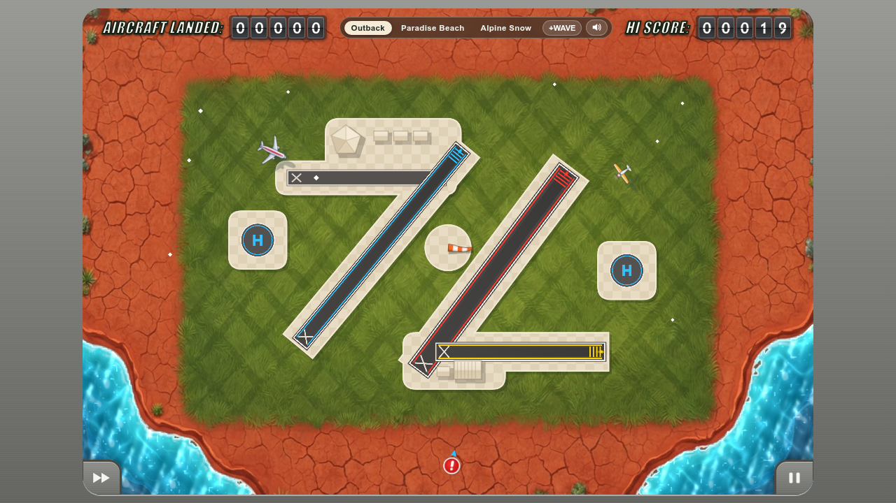
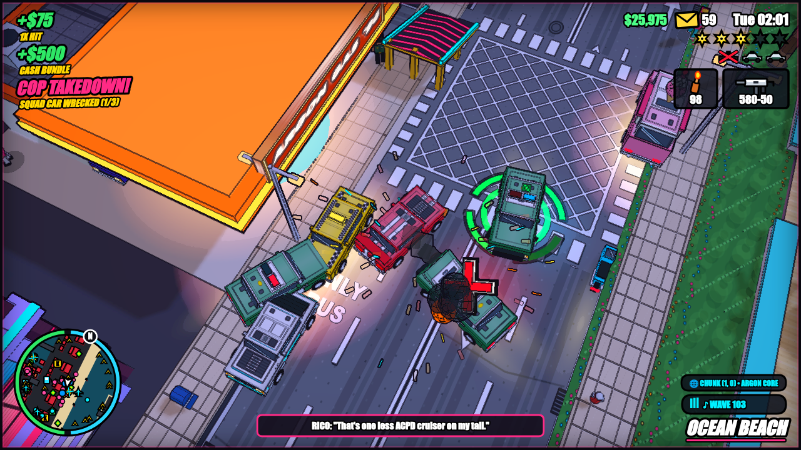
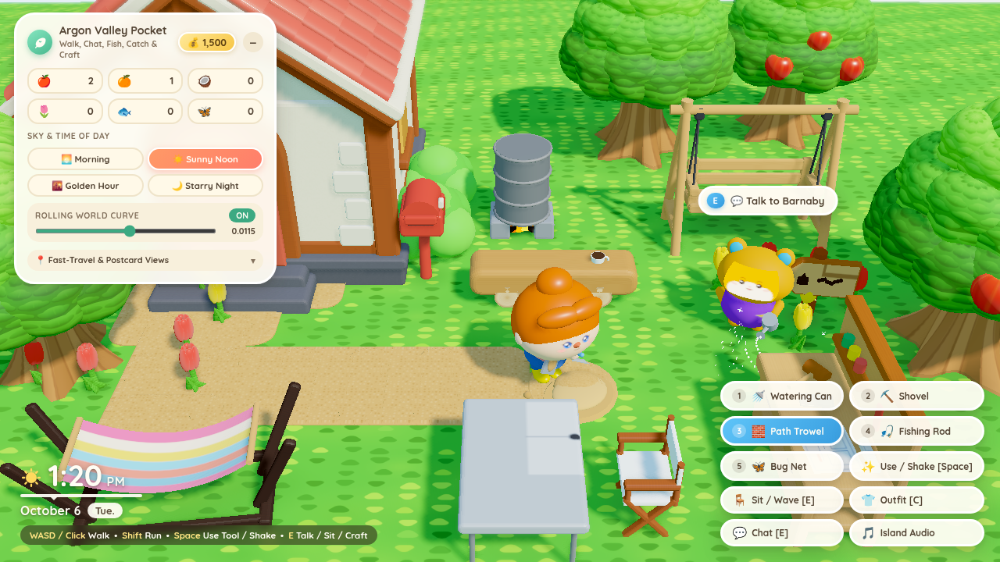
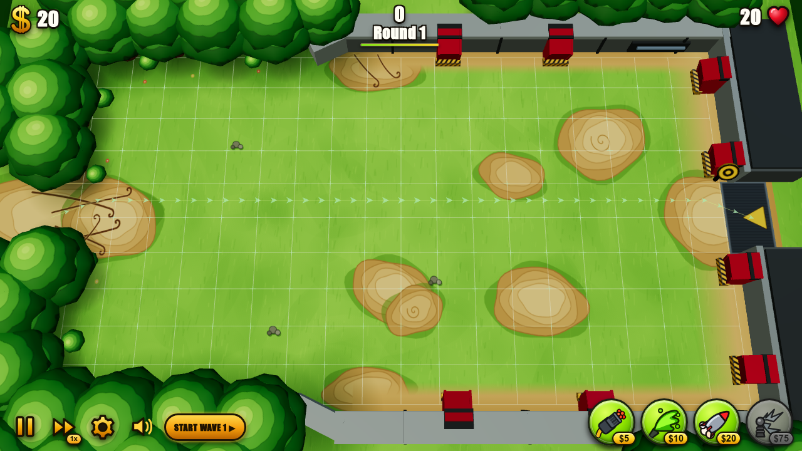
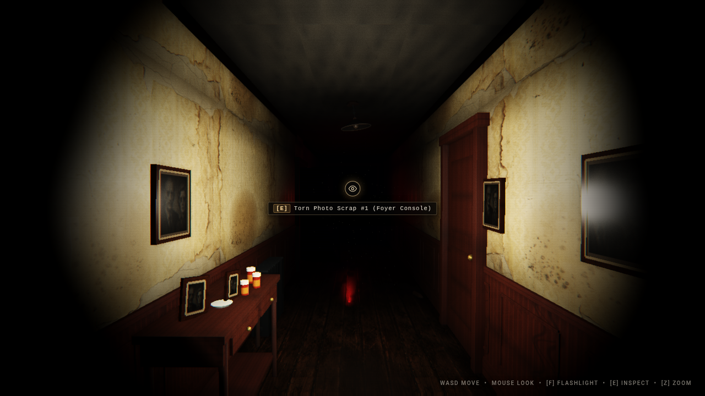

# Argon games

Six 3D web games built with **Argon** using Three.js, custom GLSL shaders, spatial Web Audio, and procedural AI voice and music pipelines. Every game runs directly in the browser with zero external engine dependencies.

> **Create games in AI Studio:** Want to build your own 3D games with Argon? Try it yourself at **[ai.studio/build](https://ai.studio/build)**.

---

## Hero showcase: Argon Tennis


**[Argon Tennis](./argon-tennis/)** is a high-speed 3D arcade tennis game featuring wrist-whip racket kinematics, expressive 3D characters, live phone gyro motion controls, webcam hand tracking, and 1v1 multiplayer.

- **Folder:** [`./argon-tennis`](./argon-tennis/)
- **What it does:** Full singles and doubles court physics, topspin/slice/lob/flat shot shaping, slow-motion power serves, instant replay camera, and a zero-install mobile companion controller (`companion.html`) that turns any phone into a live gyro racket via QR scan.
- **Run locally:**
  ```bash
  cd argon-tennis
  python3 server.py --port 8080
  # Open http://localhost:8080
  ```

---

## Game catalog

| Game | Folder | Genre & tech highlights | Quick run |
| :--- | :--- | :--- | :--- |
| **[Argon Tennis](./argon-tennis/)** *(Hero)* | [`argon-tennis/`](./argon-tennis/) | 3D arcade tennis • Phone gyro & webcam motion controls • 1v1 multiplayer relay | `cd argon-tennis && python3 server.py --port 8080` |
| **[Argon Airspace](./argon-airspace/)** | [`argon-airspace/`](./argon-airspace/) | 1950s air traffic management • Multi-touch Catmull-Rom flight paths • 3 airfields | `cd argon-airspace && python3 -m http.server 8081` |
| **[Grand Theft Argon](./grand-theft-argon/)** | [`grand-theft-argon/`](./grand-theft-argon/) | 1986 cel-shaded 3D open-world action • Helicopters, boats, traffic & 6-star tactical heat | `cd grand-theft-argon && python3 -m http.server 8082` |
| **[Argon Valley](./argon-valley/)** | [`argon-valley/`](./argon-valley/) | Cozy 3D valley & island life sim • Rolling-world vertex shader • Fishing, bugs & crafting | `cd argon-valley && python3 server.py --port 8083` |
| **[Argon Towers](./argon-towers/)** | [`argon-towers/`](./argon-towers/) | 2.5D tactical tower defense • Dynamic A* pathfinding & open-field mazing • 100 waves | `cd argon-towers && python3 -m http.server 8084` |
| **[The Corridor](./the-corridor/)** | [`the-corridor/`](./the-corridor/) | Photorealistic psychological horror • Flashlight PBR & 35mm surveillance shader • 5 mutating loops | `cd the-corridor && python3 server.py --port 8085` |

---

## 1. Argon Tennis


- **Controls:**
  - **Mouse / trackpad:** Move cursor to aim; swipe or click to swing as the ball enters your strike zone.
  - **Keyboard:** `WASD` / Arrow keys to position on court; `Space` to toss and hit serves; `1` / `2` / `3` for Topspin, Slice, and Lob.
  - **Phone motion controller:** Click **Phone Controller** on the HUD and scan the QR code on your phone to swing with real 60Hz accelerometer and gyroscope telemetry.
  - **Webcam motion:** Click **Webcam Motion** to swing using real-time optical hand tracking.
- **Details:** See [`argon-tennis/README.md`](./argon-tennis/README.md).

---

## 2. Argon Airspace



- **What it can do:**
  - Drag smooth Catmull-Rom spline approach paths from any aircraft to its color-matched runway or helipad.
  - 4 distinct aircraft classes (jetliners, twin-props, vintage biplanes, and rescue rotorcraft) across 3 airfields (*Classic Outback*, *Resort Atoll*, and *Naval Carrier*).
  - Real-time TCAS proximity alerts, weather wind gusts, 2x fast-forward mode, and vintage cabin PA voice callouts.
- **Run locally:**
  ```bash
  cd argon-airspace
  python3 -m http.server 8081
  # Open http://localhost:8081
  ```
- **Details:** See [`argon-airspace/README.md`](./argon-airspace/README.md).

---

## 3. Grand Theft Argon



- **What it can do:**
  - Explore an infinite, procedurally streamed 1986 neon metropolis with ink-outlined cel-shading, dynamic day/night cycles, and 3 camera perspectives.
  - Drive exotic sports cars, commandeer speedboats in the marina, or fly helicopters and seaplanes from the airport.
  - Interactive hotwiring, lockpicking, and tactical missions alongside a 6-star ACPD police pursuit system with roadblocks, SWAT vans, and searchlight choppers.
- **Run locally:**
  ```bash
  cd grand-theft-argon
  python3 -m http.server 8082
  # Open http://localhost:8082
  ```
- **Details:** See [`grand-theft-argon/README.md`](./grand-theft-argon/README.md).

---

## 4. Argon Valley



- **What it can do:**
  - Custom cylindrical curved-world vertex shader that bends terrain, rivers, waterfalls, trees, and buildings over a rolling horizon.
  - Equip tools (`1` Fishing Rod, `2` Shovel, `3` Bug Net, `4` Watering Can) to catch fish, net butterflies, dig up coin pouches, shake fruit trees, and craft valley furniture.
  - Chat and trade gifts with valley villagers across 4 real-time lighting presets (*Morning*, *Noon*, *Golden Hour*, and *Starry Night*).
- **Run locally:**
  ```bash
  cd argon-valley
  python3 server.py --port 8083
  # Open http://localhost:8083
  ```
- **Details:** See [`argon-valley/README.md`](./argon-valley/README.md).

---

## 5. Argon Towers



- **What it can do:**
  - Open-field mazing tower defense across an 18×10 tactical grid where every turret placement dynamically recalculates A* enemy paths in real time.
  - Anti-blocking rule enforcement with live dotted path previews before you commit to building.
  - 4 upgradeable 3D turret types (*Gatling*, *Goo*, *Missile*, and *Tesla*) vs. 6 ground and air unit archetypes across 100 rounds.
- **Run locally:**
  ```bash
  cd argon-towers
  python3 -m http.server 8084
  # Open http://localhost:8084
  ```
- **Details:** See [`argon-towers/README.md`](./argon-towers/README.md).

---

## 6. The Corridor



- **What it can do:**
  - First-person psychological horror engine inside a looping L-shaped suburban corridor that mutates across 5 escalating loops.
  - Custom 35mm surveillance post-processing shader with chromatic aberration, film grain, and an authentic pocket-flashlight shadow cone.
  - Collect 6 torn photograph fragments and solve environmental audio-visual riddles while evading a reactive apparition.
- **Run locally:**
  ```bash
  cd the-corridor
  python3 server.py --port 8085
  # Open http://localhost:8085
  ```
- **Details:** See [`the-corridor/README.md`](./the-corridor/README.md).

---

## Running all games from the repository root

You can also serve the entire collection from the root folder:

```bash
python3 -m http.server 8000
```

Then open any game in your browser:
- `http://localhost:8000/argon-tennis/`
- `http://localhost:8000/argon-airspace/`
- `http://localhost:8000/grand-theft-argon/`
- `http://localhost:8000/argon-valley/`
- `http://localhost:8000/argon-towers/`
- `http://localhost:8000/the-corridor/`

---

## Create games in AI Studio

Ready to build your own games with Argon? Start creating at **[ai.studio/build](https://ai.studio/build)**.
