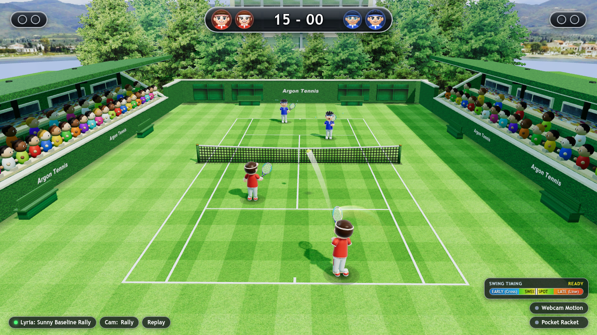

# Argon Tennis

High-speed 3D arcade tennis built in Three.js with wrist-whip racket kinematics, expressive 3D characters, phone gyro motion controls, webcam hand tracking, and 1v1 multiplayer.
> **Create games in AI Studio:** Try building your own 3D games with Argon at **[ai.studio/build](https://ai.studio/build)**.




## What it does
- **Wrist-whip racket kinematics:** Timing and swing speed determine shot angle, topspin, slice, lob, and cross-court winners.
- **3 control modes:** Mouse/keyboard, live webcam optical hand tracking, and a zero-install mobile companion controller (`companion.html`) via QR scan.
- **Solo & 1v1 multiplayer:** Play casual or pro AI rallies, or spin up a 1v1 multiplayer court room.

## How to run
```bash
python3 server.py --port 8080
```
Then open `http://localhost:8080` in your browser.

---

**Create games in AI Studio:** [ai.studio/build](https://ai.studio/build)
